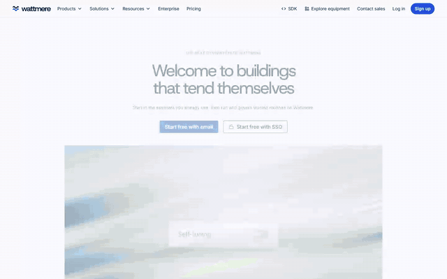

# Wattmere

Website SaaS fiktif untuk **platform energi dan kontrol gedung**: menghubungkan chiller, AHU, meter, lampu, dan baterai, menjalankannya lewat "routines" di dalam batas yang disepakati, dan mencatat setiap perubahan. Sasarannya tim fasilitas, manajer energi, IT/OT, dan pemilik portofolio gedung. Ini rebuild orisinal yang terinspirasi tata letak dan perilaku sebuah situs SaaS otomasi; konsep produk, warna, teks, logo, nama klien, gambar, dan kode dibuat baru. Copy situs berbahasa Inggris.

## Halaman (93)

| Halaman | Isi |
|---|---|
| `index.html` | Home: hero film produk, fitur, slider tingkat otonomi, carousel cerita, keamanan |
| `routines.html` | Produk utama: tab film, slider otonomi, fitur inti, FAQ |
| `link.html` | Gateway untuk asisten: langkah kerja, angka, contoh pemakaian |
| `operators.html`, `sdk.html`, `ledger.html`, `requests.html`, `floorplan.html`, `concierge.html` | Halaman produk (satu template, isi berbeda) |
| `pricing.html` | Harga interaktif, tabel perbandingan, FAQ per topik |
| `enterprise.html` | Penawaran enterprise dan formulir |
| `govern.html`, `security.html` | Tata kelola dan keamanan |
| `equipment.html` + `equipment/` (22) | Direktori peralatan dan halaman detail tiap peralatan |
| `playbooks.html` + `playbooks/` (20) | Galeri playbook dan halaman detail |
| `solutions/` (8) | Halaman per tim: facilities, energy managers, IT and OT, dan lain-lain |
| `stories.html` + `stories/` (8) | Cerita pelanggan (fiktif) dan detailnya |
| `blog.html` + `blog/` (12) | Blog dan artikel |
| `contact.html`, `signup.html`, `login.html` | Formulir kontak 2 langkah, daftar, masuk |
| `legal.html`, `privacy.html`, `404.html` | Dokumen contoh dan halaman error |

## Fitur dan interaksi

- Mega menu 3 panel (klik, Esc, scrim), drawer mobile dengan accordion.
- "Film produk" dibuat dari HTML/CSS (bukan video): adegan berurutan, tombol pause/play, hanya berjalan saat terlihat.
- Slider tingkat otonomi 4 titik, carousel cerita (tombol dan swipe), marquee logo, accordion, tab, modal film dan pilihan privasi.
- Pricing: slider point, bulanan/tahunan, mata uang, tab add-on, tooltip, tabel fitur lipat.
- Direktori peralatan: cari, urutkan, kategori, huruf (`equipment.html#m`), load more, keadaan kosong.
- Filter cerita dan playbook, pencarian, tombol salin kode, progress baca artikel.
- Formulir hanya validasi di browser. **Tidak ada data yang dikirim.**
- Scroll native, reveal ringan, hormat `prefers-reduced-motion`. Tanpa sound (referensi juga tidak memakai sound UI).
- Responsif desktop dan mobile.

## Teknologi

HTML, CSS, dan JavaScript native. Tanpa framework, tanpa build, tanpa dependensi. Font lokal di `assets/fonts/`: **Host Grotesk** (judul, pengganti font display berlisensi), **Newsreader** (serif, pengganti font serif berlisensi), **Inter** (teks).

## Menjalankan

Buka `index.html` langsung di browser.

## Struktur

```
├── index.html, blog.html, stories.html, ... (24 halaman di root)
├── blog/        12 artikel
├── equipment/   22 detail peralatan
├── playbooks/   20 detail playbook
├── solutions/    8 halaman tim
├── stories/      8 detail cerita
├── assets/
│   ├── favicon.svg
│   ├── fonts/    5 woff2
│   └── img/      50 jpg
├── css/
│   ├── style.css  token, header, footer, komponen bersama
│   ├── film.css   adegan film produk
│   └── pages.css  template halaman dalam
├── js/main.js     semua interaksi
└── docs/preview/  homepage.gif, hero.png
```

## Mengedit

Edit langsung file HTML/CSS/JS; tidak ada generator.

- **Warna:** variabel di `:root`, awal `css/style.css` (`--accent`, `--ink`, `--deep`, `--citron`, `--mist`, dan lainnya). Warna logo di SVG header ditulis langsung (`#2450e0`).
- **Teks:** di HTML masing-masing. Header, mega menu, dan footer diulang di tiap halaman, jadi ubah dengan cari-ganti di semua file.
- **Harga:** `data-base` di `pricing.html`; faktor tier dan kurs di `js/main.js` bagian `pricing`.
- **Gambar:** timpa file di `assets/img/` dengan nama yang sama.

## Placeholder yang perlu diganti

- Nama brand Wattmere, logo, tagline, dan domain email `@wattmere.example`.
- Nama klien, peralatan, orang, kutipan, dan semua angka (3,400 buildings, 4,000+ models, persentase, hasil cerita): **semuanya fiktif**.
- Klaim SOC 2, SOC 3, GDPR, CCPA di halaman keamanan adalah contoh. Hapus atau ganti bila tidak benar untuk perusahaan Anda.
- `npm install @wattmere/sdk` hanya contoh, paketnya tidak ada.
- Legal dan Privacy hanya teks contoh. Ikon sosial mengarah ke `blog.html`.
- Beberapa tautan (Academy, Help Center, Webinars, Docs) mengarah ke halaman terdekat yang ada.

## Kredit aset

- Gambar: dibuat AI (Nano Banana via Google Flow). Wajah di foto bukan orang nyata.
- Ikon, logo, dan film produk: SVG/CSS buatan sendiri.
- Font: Host Grotesk, Newsreader, Inter (Google Fonts, SIL Open Font License).

## Keterbatasan

- Font display dan serif adalah pengganti, jadi bentuk huruf dan pemenggalan baris tidak identik dengan referensi.
- Video referensi diganti film HTML/CSS; adegan dan temponya dibuat ulang, bukan salinan.
- Home cocok sampai sekitar 20 px pada posisi section (tinggi total 9.657 px, referensi 9.639 px). Halaman dalam mengikuti struktur dan gaya terukur, tetapi lebih pendek karena isinya lebih ringkas (misalnya daftar cerita dan playbook). Galeri playbook tidak memuat ratusan item seperti referensi.
- Halaman referensi yang jumlahnya ribuan diwakili satu template dengan jumlah contoh terbatas. Widget chat pihak ketiga tidak dibuat.
- Uji scroll (17 template, 1440 dan 390 px): 55,9 sampai 60 fps, frame terburuk 50 ms. Satu pengecualian: pada halaman playbook single desktop, dua cek kendali otomatis (override dan End) gagal karena halamannya pendek. Halaman kosong dengan tinggi serupa gagal sama, dan uji manual lolos.
